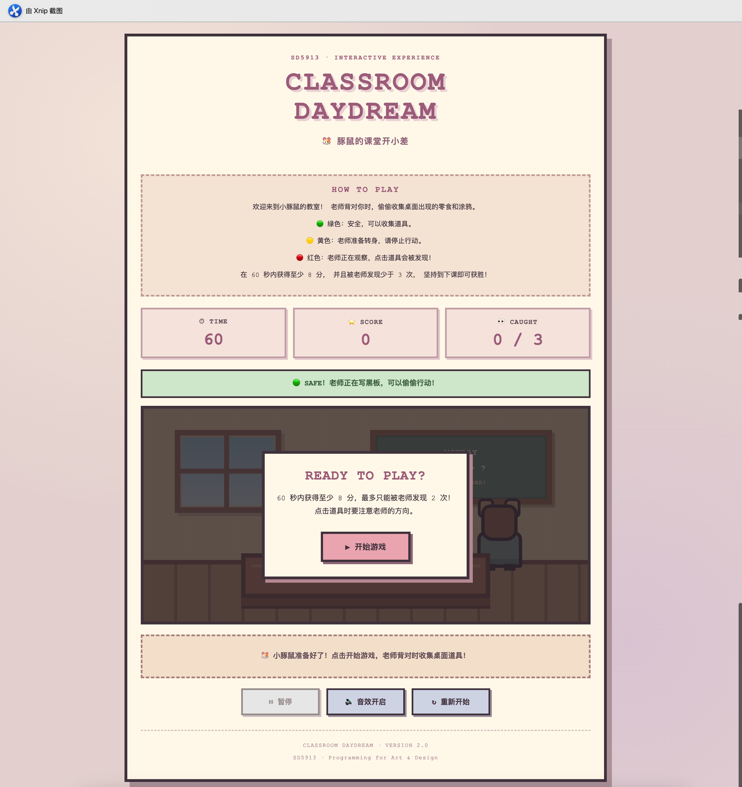
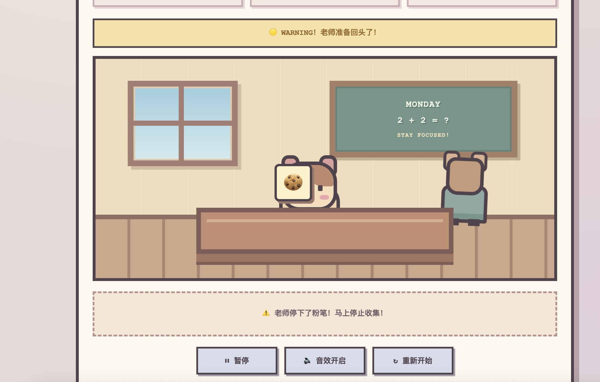
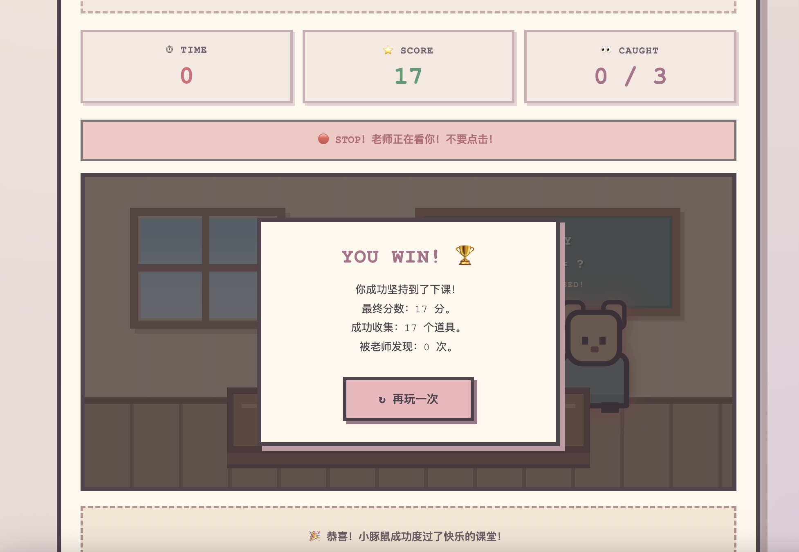

# PROCESS – Classroom Daydream

**Course:** SD5913 – Programming for Art & Design  
**Assignment:** Assignment 3 – An Interactive Experience  
**Project:** Classroom Daydream — V2.1 Development Log  
**Project Type:** Individual Interactive Browser Game  
**Tools:** VS Code, GitHub, HTML, CSS, JavaScript, ChatGPT

---

## 1. Starting Idea

Classroom Daydream began with a simple observation of everyday student life: students sometimes become distracted during class.

I wanted to transform this familiar situation into a playful interactive experience where users could make choices and immediately understand the consequences of their actions.

The original idea involved a student secretly doodling, eating snacks, or paying attention to the teacher.

My central design question was:

**How can an ordinary classroom distraction become a meaningful interactive experience through user input, program response, and feedback?**

I chose a small browser-based game because it could be developed, tested, and shared without additional hardware or paid services.

---

## 2. Initial Prototype – Version 1.0

The first prototype was created using HTML, CSS, and JavaScript.

HTML defined the classroom scene, action buttons, progress bars, and feedback messages.

CSS provided the visual design, including the classroom environment, student character, teacher, and simple animations.

JavaScript controlled the game state, player actions, sound effects, and winning conditions.

### Main Interactions

The player could choose between three actions:

- Doodle
- Eat snacks
- Study

Each action changed two values: Mood and Risk.

Doodling and eating snacks increased mood but also increased the risk of being caught.

Studying reduced risk but slightly decreased mood.

### Input–Response–Feedback Loop

**Input:** The player clicked an action button.

**Response:** JavaScript changed the mood and risk values.

**Feedback:** Progress bars, text messages, sound effects, and short animations communicated the result.

### Initial Limitations

Although the first version was functional, the interactions were relatively predictable.

The player could reach the winning condition through repeated actions without needing to observe the environment.

The visual design also lacked consistency because different elements used different illustration styles.

These weaknesses became clearer during user testing.

---

## 3. First User Trial – Version 1.0

I conducted an informal usability test with four participants, identified anonymously as A, B, C, and D.

The participants provided feedback on gameplay, visual design, interaction mechanics, and character identity.

### Participant A – Game Logic

Participant A felt that the game was too easy to win through repetitive clicking.

The original winning condition depended mainly on accumulated mood, risk, and the number of actions.

This encouraged players to repeat rewarding actions instead of making meaningful decisions.

### Participant B – Visual Design

Participant B described the interface as visually rough.

The classroom scene, student, teacher, and interactive objects did not share a sufficiently consistent visual language.

The participant's feedback suggested that the visual experience needed stronger coherence.

### Participant C – Interaction Mechanics

Participant C suggested taking inspiration from *Red Light, Green Light* and *Whac-A-Mole*.

These games involve timing, observation, and reaction.

This suggestion helped me reconsider how the teacher could become an active part of the gameplay rather than a decorative character.

### Participant D – Character Design

Participant D suggested replacing the human student with a guinea pig.

A guinea pig character could make the experience more playful, expressive, and memorable.

The suggestion also created an opportunity to explore a distinctive character identity.

---

## 4. Analysis of the First User Trial

The first trial revealed four main issues:

1. Repetitive actions made winning too predictable.
2. The visual elements lacked a consistent style.
3. The teacher had limited influence on player decisions.
4. The student character was not sufficiently expressive.

The most important problem was the relationship between user action and game consequences.

In Version 1.0, players did not need to observe changing conditions before clicking.

I therefore decided to redesign the core interaction instead of simply adjusting numerical scores.

The revised game would encourage players to observe the teacher, recognise safe and dangerous moments, and make decisions based on timing.

---

## 5. Design Iteration – Version 2.0

Based on the first user trial, I redesigned Classroom Daydream as a timing-based interactive game featuring a guinea pig student.

### Change 1 – Teacher Observation Mechanic

The teacher now has three states.

**GREEN – SAFE**

The teacher faces the blackboard.

The player can collect objects and earn points.

**YELLOW – WARNING**

The teacher is preparing to turn around.

The player is encouraged to stop interacting.

**RED – DANGER**

The teacher watches the classroom.

Collecting an object increases the caught counter.

This mechanic was inspired by the observation and timing principles of *Red Light, Green Light*.

### Change 2 – Random Collectible Objects

The original fixed action buttons were replaced by randomly appearing objects.

The objects include:

- Carrot
- Cookie
- Doodle
- Star

Objects appear at different positions in the classroom and disappear after a short period.

Once an object is collected, it is removed from the active game state to prevent repeated scoring.

This interaction was influenced by the reaction-based structure of *Whac-A-Mole*.

### Change 3 – New Winning Conditions

Version 1.0 used mood and risk thresholds.

Version 2.0 introduced a 60-second game session.

The player must collect at least eight points and avoid being caught three times.

Reaching eight points does not immediately end the game.

The player must survive until the countdown reaches zero.

This creates a stronger relationship between observation, timing, and decision-making.

### Change 4 – Guinea Pig Character

The human student was replaced with a guinea pig character.

The guinea pig was created using simplified CSS shapes to match the pixel-inspired classroom environment.

Basic happy and frightened animations were introduced to provide feedback.

### Change 5 – Interface and Feedback

Version 2.0 introduced:

- Countdown timer
- Score counter
- Caught counter
- Colour-coded teacher states
- Random collectible objects
- Sound effects
- Short character animations
- Text feedback
- Win and loss screens
- Pause, resume, and restart controls

These features were intended to make the game state and consequences easier to understand.

---

## 6. Technical Implementation

The project uses HTML, CSS, and vanilla JavaScript.

No external JavaScript framework, backend, paid API, or machine learning model is required.

### HTML

HTML defines the structure of the interface and interactive elements.

It includes the classroom environment, teacher, guinea pig, collectible objects, score display, controls, and game result overlay.

### CSS

CSS is responsible for the visual design and animations.

It creates the classroom environment, characters, responsive layout, buttons, warning states, and effects.

### JavaScript

JavaScript controls the game state and interactions.

Important functions include:

- `createInitialState()` – creates the initial game state.
- `updateHUD()` – updates the timer and score display.
- `advanceTeacherState()` – controls teacher behaviour.
- `spawnItem()` – generates random collectibles.
- `collectItem()` – processes player interactions.
- `gameTick()` – updates the game timer.
- `pauseGame()` – pauses gameplay.
- `resumeGame()` – resumes gameplay.
- `finishGame()` – determines the game result.
- `resetGame()` – resets the game.

The main interaction is controlled by checking the teacher's current state when the player clicks a collectible object.

---

## 7. Input → Response → Feedback

The most important interaction is collecting an object while observing the teacher.

### Input

The player clicks a collectible object, such as a carrot or doodle.

### Response

JavaScript checks the teacher's state.

If the teacher is facing the blackboard, the player gains one point.

If the teacher is preparing to turn around, the player receives no points.

If the teacher is watching, the caught counter increases.

### Feedback

The interface communicates the result through:

- Numerical score changes
- Teacher status indicators
- Text messages
- Sound effects
- Short character animations
- Visual effects

The player uses the feedback to decide when to make another attempt.

This creates a loop of observation, action, response, feedback, and decision-making.

---

## 8. Error and Interruption Handling

The game includes several safeguards.

### Repeated Clicks

A collectible object disappears immediately after being clicked.

This prevents the player from receiving multiple points from the same object.

### Invalid Game States

Objects cannot be collected before the game begins, while paused, or after the game ends.

### Timer Management

The program stops an existing timer before starting another one to prevent duplicate countdown intervals.

### Browser Interruption

The game automatically pauses when the browser tab becomes hidden or the window loses focus.

### Audio Availability

Sound effects are optional.

If the browser cannot play audio, the core game remains functional.

### Restart

The restart control resets the timer, score, caught counter, teacher state, and collectible objects.

These safeguards help make the experience more reliable and understandable.

---

## 9. AI Tools and Design Decisions

I used ChatGPT as an AI-assisted development tool throughout the project.

ChatGPT helped me:

- Interpret the assignment requirements.
- Develop and compare interactive game ideas.
- Draft HTML, CSS, and JavaScript code.
- Understand VS Code and GitHub workflows.
- Investigate programming and local server errors.
- Explore gameplay improvements.
- Structure project documentation.

### AI Suggestion Kept

I retained the suggestion to build the game around a clear input-response-feedback cycle.

The revised teacher observation system makes this relationship more meaningful because the player must observe changing conditions before acting.

### AI Suggestion Changed

An earlier AI-assisted implementation relied on fixed buttons that increased or decreased mood and risk.

After the first user trial, I changed this design because it encouraged repetitive clicking.

The revised game uses teacher observation, random collectibles, and timing-based decisions.

This change was informed by real user feedback rather than simply accepting the initial AI-generated solution.

### Reflection on AI Usage

AI was useful for rapid prototyping and technical learning.

However, user testing revealed problems that were not obvious from the code alone.

The second user trial showed that technically correct feedback is not necessarily engaging or expressive from the player's perspective.

---

## 10. Visual Design Decisions

The visual design uses a soft, pixel-inspired classroom style.

The main colours include:

- Cream
- Dusty pink
- Warm brown
- Muted green
- Pale yellow

The classroom includes a window, blackboard, desk, teacher, and guinea pig student.

The guinea pig was introduced in response to Participant D's feedback.

The teacher's states are communicated through green, yellow, and red visual indicators, accompanied by text labels.

The purpose was to create a playful environment while keeping the gameplay information clear.

Although Version 2.0 improved visual consistency, later testing revealed that the character still lacked sufficiently expressive reactions.

---

## 11. Screenshots and Development Evidence

Screenshots of Version 2.0 are stored in the `assets` folder.

### Main Game Interface

### Teacher Warning State

### Teacher Observation State

### Game Result

### Failure Result

The GitHub commit history records the development process and code revisions.

---

## 12. Second User Trial – Version 2.0

### Participant

Participant A, who previously identified the repetitive-clicking issue in Version 1.0, tested Classroom Daydream V2.0.

### Test Procedure

The participant played the updated browser game featuring a 60-second timer, randomly appearing collectibles, and teacher observation mechanics.

The gameplay session was screen-recorded to document the interaction.

### Observation

The recording shows the participant interacting with randomly appearing objects while the teacher changes between different observation states.

The score counter responds to successful actions, and the interface provides visual information about the teacher's status.

However, the guinea pig character appears relatively passive during collection.

Although the program includes short character animations, these reactions are not sufficiently prominent to make the character's participation noticeable.

The most obvious results are changes in the score and the disappearance of collectible objects.

### Participant Feedback

Participant A felt that the game mechanics remained relatively simple.

The participant also commented that the clicking effects and visual presentation lacked creativity, and that the interaction was still repetitive.

For example, when the teacher faced away, clicking a carrot or drawing object successfully increased the score.

However, the guinea pig did not appear to respond in a sufficiently noticeable or meaningful way.

The participant felt that the experience was primarily about clicking objects to gain points rather than interacting with the character.

### Analysis

This feedback revealed a distinction between functional feedback and experiential feedback.

At a technical level, the program responds correctly to player input by changing values and triggering effects.

However, these responses do not necessarily make the player feel that their actions have affected the virtual world.

Different objects currently produce similar character reactions.

For example, collecting a carrot should feel different from collecting a drawing object.

The game needs clearer object-specific reactions that connect player actions with the guinea pig's behaviour.

### Design Decision

Based on this feedback, I decided to prioritise improving the expressiveness of the existing interactions rather than adding more complex game mechanics.

The next iteration will focus on making the character visibly respond to different objects and situations.

### Version 2.1 Improvement Plan (subsequently prototyped locally)

**1. Eating Interaction**

Clicking a carrot will trigger an animation in which the food moves toward the guinea pig.

The guinea pig will chew, puff its cheeks, and display a happy expression.

**2. Drawing Interaction**

Clicking a doodle object will trigger a drawing animation.

The guinea pig will move its paws, and a small drawing will appear.

**3. Distinct Object Feedback**

Carrots, cookies, doodles, and stars will produce different animations and sound effects.

**4. Teacher Warning Reaction**

When the teacher prepares to turn around, the guinea pig will visibly stop its activity and attempt to appear attentive.

**5. Caught Reaction**

When the teacher catches the player, the guinea pig will display a more obvious frightened expression.

The scene will also provide stronger visual feedback.

### Current Status

The second user trial has been completed and documented.

This statement describes the V2.0 retest period. By 27 October 2026, a subsequent V2.1 pixel-item iteration had been prototyped locally; see the dated development addendum below for the distinction between local work and the GitHub Pages release.

Further testing will be needed to evaluate whether the additional animations improve engagement.

---

## 13. Known Limitations

The current Version 2.0 has several limitations.

First, the game contains only one level and a fixed 60-second session.

Second, the interaction mainly focuses on collecting objects and avoiding the teacher's attention.

Third, the guinea pig character has limited expressive animation.

Different collectible objects do not yet produce sufficiently distinct character behaviours.

Fourth, the collectible objects use emoji, which may display differently across operating systems.

Fifth, the game does not save progress after the browser is refreshed.

The second user trial identified character responsiveness as the most important area for future improvement.

---

## 14. Final Reflection

The development of Classroom Daydream demonstrates how user testing can identify weaknesses in an interactive experience that are not immediately obvious during implementation.

Version 1.0 established a basic input-response-feedback loop through mood and risk values.

However, the first user trial revealed that the interaction rewarded repetitive clicking and lacked visual consistency.

Version 2.0 introduced a guinea pig character, random collectible objects, and a teacher observation mechanic.

These changes created a stronger relationship between observation, timing, and player decisions.

The second user trial revealed another important problem.

Although the game became more functional, the interaction still lacked sufficiently expressive character responses.

This showed me that **a working interaction is not necessarily an engaging interaction**.

Meaningful feedback should communicate more than changes in numerical values.

It should help users understand and feel how their actions affect the virtual environment.

My next design direction therefore focuses on building a stronger connection between collectible objects, guinea pig behaviours, and the player's sense of participation.

Overall, this project helped me understand the importance of prototyping, user observation, design iteration, and feedback in interactive experience design.

Rather than simply adding more features, I learned to focus on making each interaction more intentional, understandable, and expressive.

---

## 15. Dated Development Addendum — V2.1 (27 October 2026)

### Motivation: Second user trial

Participant A's V2.0 retest showed that collecting different objects was still perceived primarily as score-raising clicks. The guinea pig's reactions were too subtle, so the participant did not clearly connect specific objects with specific character behaviours.

**Research-to-design decision:** Keep the existing teacher observation game loop and make the four existing objects more legible, differentiated and expressive. This avoids increasing scope with new mechanics immediately before the assignment deadline.

### Visual iteration

The previous orange square character was refined into a **tricolour guinea pig** with short rounded ears, a white centre face, brown/orange patches, small eyes and an expressive mouth. The warm classroom palette remained consistent.

A later development screenshot provided on 27 October 2026 shows a pixel-art cookie appearing without a square button background next to the tricolour guinea pig. This is evidence of the **local visual result**, not proof that the public deployment contains the same code.

### Item-specific input → response → feedback

| Player input (safe teacher state) | Program response | Perceptible visual feedback |
| --- | --- | --- |
| Collect carrot | Award 1 point, trigger carrot action | Carrot moves to mouth, cheeks alternately expand, guinea pig chews |
| Collect cookie | Award 1 point, trigger cookie action | Cookie moves toward mouth; pixel crumbs, closed happy eyes and side-to-side motion |
| Collect doodle | Award 1 point, trigger doodle action | Pencil moves over foreground paper; a pixel flower appears progressively |
| Collect star | Award 1 point, trigger celebration | Guinea pig jumps; pixel star and sparkle particles appear |

The local implementation generates small transparent pixel sprites with code rather than relying on operating-system emoji images. This improves visual consistency and removes the unwanted collectible background boxes.

### Foreground-layer correction

**Problem:** `.student { z-index: 4 }` and `.desk { z-index: 5 }` placed the guinea pig behind the desk. Raising child effects to a higher z-index could not escape the parent's stacking context.

**Change:** A sibling HTML element `#interaction-layer` sits above the desk and receives temporary food, pencil, drawing and sparkle effects. Its position is measured relative to the displayed guinea pig, supporting responsive positioning.

### What remains unchanged

The core V2.0 rules remain: a 60-second session, a target of eight points, three caught attempts resulting in failure, green/yellow/red teacher states, and pause/resume/restart. The design iteration prioritises clearer feedback rather than adding rules.

### Testing evidence and limitations

- **Observed:** The provided local screenshot shows a tricolour guinea pig, classroom background and unboxed pixel cookie.
- **Reported work:** The source changes prepared locally include the four distinct object-response animations.
- **Not yet verified here:** Complete animation sequences, usability impact, keyboard/mobile interaction, timer edge cases and Pages deployment.
- **Next user trial:** Ask someone to identify the action being performed **without reading the feedback message**. Record which actions are immediately recognisable and where the animation remains ambiguous.

### AI assistance and authorship

ChatGPT supported prototyping of CSS character styling, transparent pixel-item generation, JavaScript animations, foreground layering and documentation. The project author selected the interaction goals, reviewed visuals, ran local previews and made iterative decisions informed by user feedback. Reference artwork was used as visual inspiration; the in-game pixel-item drawings were developed programmatically rather than copied directly from the reference image.

### Version control and release status

The GitHub default branch was checked on 27 October 2026 and still contained earlier versions of the game files. This addendum records progress **without claiming the latest local build has already been deployed**. To complete the V2.1 release, the latest local HTML, CSS, JavaScript and screenshot need to be committed and pushed, followed by a GitHub Pages check.
